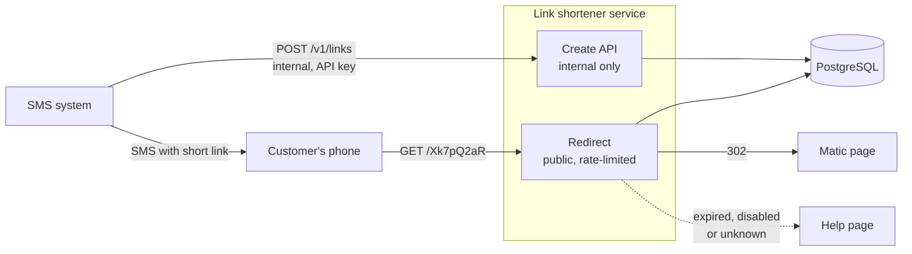

# Link shortener: spec, architecture and rollout

Draft, based on `notes.md`, `research.md` and `../clarifications.md`.

## 1. Summary

**Recommendation:** build our own small link shortener on a Matic-branded short domain. A short link can lead to a customer's insurance documents, so we want full control over how links are made, how long they live and where they are stored.

**What you get:** the SMS system swaps each long link in a message for a short one, like `mtc.example/Xk7pQ2aR` (placeholder domain). The customer taps it and lands on the same page as before. A link can expire, and can be switched off at once if an SMS went to the wrong number; either way the customer sees a page that says what to do next. If the shortener is down, the SMS still goes out with the long link.

**Cost:** building takes about 4 engineer-weeks (one engineer) (section 6), then roughly low hundreds of dollars a month to run, plus a team that owns it and is on call. Buying at 1.5M links a month needs an enterprise contract: known prices range from about $1,800 a year (Short.io, unconfirmed for our volume) to up to $22,500 a month (shortening built into the SMS provider).

**Timeline:** build 3–4 weeks to build, a 2-week pilot on one SMS template, then 2–4 weeks to move the other templates: 7–10 weeks in total

## 2. Context and assumptions

| What we know or assume | Status | Source: `../clarifications.md`, Task 2 |
|---|---|---|
| First use is SMS to customers; other channels may follow, so nothing is SMS-only. | Confirmed | Q1 |
| Only internal systems create links; anyone with a link can open it. | Confirmed | Q2 |
| Links are not posted publicly (social media, campaigns). | Assumed | Q2 |
| ~1.5M links a month: ~49,000 a day, 18M a year. | Confirmed | Q3 |
| ~3 opens per link: 2 by the customer, 1 by a link preview or scanner. | Assumed | Q3, research |
| A link can lead to sensitive data, e.g. a policy declarations page. | Confirmed | Q4 |
| No expiry or audit rules were given; ours below are a proposal. | Assumed | Q4 |
| What to track is up to us. Main goal is shorter SMS; tracking is a bonus. | Confirmed / Assumed | Q5, notes |
| The caller is the system that generates SMS text, with zero or more links. | Confirmed | Q6 |
| Cost is build vs. buy (confirmed), covering effort and running cost (assumed). | Confirmed / Assumed | Q7 |
| No constraints on stack, cloud, domain or deadline. | Confirmed | Q8 |

## 3. Scope

**First release:** internal batch create API (section 4) with a key per calling system; public redirect on a Matic-branded domain; random 8-character codes, never reused; optional expiry per link; quick disable; Matic domains only; a help page for expired, disabled and unknown links; a click counter per link (a rollout health signal, bots included); redirect rate limiting and a "not found" alert; backups; the SMS system change behind a feature flag, with fallback to long links.

**Later, if asked for:** a "whole text" endpoint (send the SMS, get it back with links replaced), built on the batch API; click reports that tell previews from real opens; other channels; a UI for agents or support.

**Out:** custom codes like `/my-policy` (guessable); links created by the public or posted on social media; non-Matic URLs.

## 4. Interface

The SMS system makes one call per message with all its links (no links, no call) and puts the short links it gets back into the text. If the call fails or times out, it sends the long links: a long SMS is better than no SMS. Batch covers the one-link case, and "whole text" can be added on top later. Each link succeeds or fails on its own, and a rejected link keeps its long URL. An `Idempotency-Key` per message makes retries safe: the same key returns the same short links.

```http
POST /v1/links
Authorization: Bearer <key of the SMS system>
Idempotency-Key: sms-8f2c41

{ "links": [
    { "url": "https://www.matic.com/policies/123/declarations", "expires_in_days": 30 },
    { "url": "https://www.matic.com/contact" },
    { "url": "https://example.com/offer" } ] }

200 OK
{ "links": [
    { "short_url": "https://mtc.example/Xk7pQ2aR", "expires_at": "2026-12-12T15:04:00Z" },
    { "short_url": "https://mtc.example/b9TzH4mW", "expires_at": null },
    { "error": "domain_not_allowed" } ] }
```

## 5. Architecture

A small separate service on the stack the team already runs, with its own PostgreSQL. Separate, so a deploy or incident in a main app can't break every link already sent, and the public short domain isn't a new way into that app. PostgreSQL is plenty: the worst burst is ~14 creations and ~41 redirects a second, and a redirect is one indexed lookup.



**Data stored:** one `links` table with code, destination URL, calling system, idempotency key, created, expiry and disabled times, and click count. Measured at 437 bytes a row with indexes: ~8 GB a year. No per-click rows, IP addresses or device data.

**Security**
- Codes: 8 random characters from 58 (no 0/O or 1/l), ~1.3×10¹⁴ codes. With a full year of links live (18M), one random guess in ~7 million hits a link.
- Rate limit on the redirect; alert when "not found" responses spike, a sign of code guessing.
- Create API on the internal network only, one key per calling system.
- Only Matic-domain URLs accepted, so our short domain can't be used for phishing.
- `302`, not `301`, so browsers don't cache redirects and disabling works at once.

**Expiry and lifecycle.** Expiry is optional, set per link by the caller. A code is never reused, even after expiry: an old SMS must never open another customer's document. One internal API call disables a link, e.g. after an SMS to the wrong number. The redirect matters more than creation, because every SMS already sent depends on it: losing the table breaks every link, so backups with a tested restore are required.

## 6. Build vs. buy

No self-serve plan goes above 50,000 links a month, so every vendor needs an enterprise contract. Prices checked 12 Nov 2026; sources in `research.md`.

| Option | Cost at 1.5M links a month | What matters |
|---|---|---|
| **Build** | Effort: about 4 engineer-weeks (16–19 days, breakdown below). Running: low hundreds of $/month (rough, to be priced), plus ownership and on-call. | Full control of codes, expiry, disabling and data. We run a public, always-on endpoint. |
| Short.io | $148/month listed (~$1,800/year), unconfirmed at this volume | "Unlimited" under an unpublished fair-use policy. 99.9% SLA. |
| Bitly | Not published; a competitor estimates $10,000+/year | Hourly API limits must be in the contract. |
| Rebrandly | Quote only | Expiry required, 90 days max; expired links are deleted. |
| Dub | Quote only | Bulk API, 100 links per call. |
| SMS provider (e.g. Twilio) | $0.015 per SMS: up to ~$22,500/month | Only if our provider offers it. Links fall back to a default URL after 90 days. |

**Estimation**
| Work | Days (low) | Days (high) | Note |
|---|---|---|---|
| Create API: keys, batch, idempotency, domain check, code generation | 3 | 3 | |
| Redirect, expiry, disable, help page, click counter | 2 | 2 | |
| New service setup: deploy pipeline, database, domain and TLS, rate limiting | 3 | 3 | |
| Monitoring, alerts, backups and a tested restore | 2 | 2 | |
| SMS system change: flag, batch call, fallback to long links | 2 | 3 | Least certain line: nothing is known about the SMS system yet. |
| Load test, security review, fixes | 2 | 3 | |
| Runbook and buffer | 2 | 3 | |
| **Total** | **16** | **19** | One engineer, first-release scope from section 3 of the spec. |
| **Engineer-weeks (5 days each)** | **3.2** | **3.8** | |

**Recommendation: build.**
- The code may be the only thing between a stranger and a customer's documents. Building lets us set code length, never reuse codes, disable links at once and keep destination URLs, which may carry access tokens, inside Matic.
- Price alone doesn't decide it: the known prices are either higher (Twilio) or unconfirmed at our volume (Short.io, Bitly). If Short.io confirms $148/month, it is cheaper than building.
- The real cost of building is owning an always-on public endpoint for as long as any link sent is live.
- Revisit if destination pages always require login (open question 1) and Short.io confirms its price in writing.

## 7. Rollout plan

| Phase | Duration | What happens | Exit criteria |
|---|---|---|---|
| 0. Prepare | 1 week, with build | Answer open questions 1–4; register the domain with auto-renew. | Answers recorded; domain registered; owner and on-call named. |
| 1. Build | 3–4 weeks | Service, redirect, help page, monitoring, backups; SMS system change behind a flag, off. | Load test at 10× burst passes; restore and long-link fallback tested; security review done. |
| 2. Pilot | 2 weeks | Flag on for one SMS template. | No wrong redirects; create errors under 0.1%; no rise in calls about broken links. |
| 3. Expand | 2–4 weeks | Flag on template by template. | Pilot criteria hold for a few days per template. |

Rollback at any phase: turn the flag off and the SMS system sends long links again. Links already sent keep working. After rollout the flag stays as a way back.

## 8. Risks and open questions

| Risk | Mitigation |
|---|---|
| A guessed code opens a customer's document; worst if the page needs no login. | 8-character codes, rate limit, "not found" alert, expiry, disabling. |
| Optional expiry means most links may never expire: live codes grow ~18M a year, and a forwarded SMS or reassigned number keeps working. | Review the expiry rule once open question 1 is answered. |
| A redirect outage breaks every link already sent. | Separate service, backups, monitoring, an owner on call. |
| The short domain lapses; whoever registers it controls every link ever sent. | Auto-renew, named owner. |

**Open questions**
1. Does the destination page ask the customer to log in, or does the long URL open the document directly? This decides how strict expiry and codes must be.
2. Which domains count as "Matic domains"?
3. Is the long URL safe to send in an SMS when the shortener is down?
4. Who owns the service and is on call? Does the redirect need 99.9% availability?
5. How long do we keep links, click counts and access logs?
6. Does the SMS system send in batches, and which SMS provider does it use (some have shortening built in)?
7. Separate service (proposed) or part of an existing app, and on which stack?
8. Why does the Call Center want short links: SMS length, readability or tracking? We assume length.
